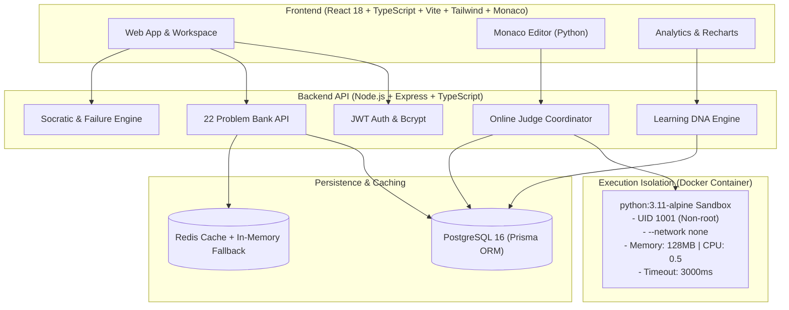

# CodeMentor AI

### Adaptive Coding Coach & Interview Intelligence Platform

[](https://github.com/username/CodeMentor-AI/actions)
[](LICENSE)
[](https://www.typescriptlang.org/)
[](https://nodejs.org/)
[](https://react.dev/)
[](https://www.docker.com/)

> **"Teach the student how to think instead of simply giving the answer."**

---

## 1. Problem Statement

Traditional competitive programming and interview prep platforms operate primarily on binary feedback: **"Accepted"** or **"Wrong Answer"**.

When students fail, they are frequently trapped in one of two extremes:
1. **Giving up** due to cryptic error messages or lack of hints.
2. **Looking up the full solution** in editorial or discussion tabs, ruining the learning process through passive memorization.

Furthermore, students have no objective insight into *which foundational concepts* they are weak in, whether their time complexity is optimal, or how prepared they genuinely are for target campus interviews (Google, Microsoft, Amazon, Meta, Atlassian, Adobe).

---

## 2. Solution: CodeMentor AI

**CodeMentor AI** bridges this gap by functioning as an intelligent, Socratic technical interview coach:
* **Decoupled Ground Truth**: Code correctness is evaluated deterministically by a secure, containerized Online Judge. The AI explains and guides rather than guessing correctness.
* **Socratic Hint Engine**: 5 progressive hint tiers prompt problem comprehension, pattern recognition, and loop invariants without spoiling the answer.
* **Why-Did-I-Fail Analyzer**: Pinpoints the exact root cause, highlights overlooked edge cases, and compares current complexity with target optimal complexity.
* **Learning DNA**: Transparent heuristic calculating 0–100 mastery across 12 core DSA categories.
* **Adaptive 4-Week Roadmap**: Dynamically generates multi-week study schedules targeting identified knowledge gaps.
* **Company Readiness**: Provides objective benchmark scores indicating preparation depth for top tech companies.

---

## 3. Core Features

| Feature | Description |
| :--- | :--- |
| **Monaco Code Editor** | Authentic VS Code editing experience with Python syntax highlighting, line numbers, and indentation. |
| **Secure Online Judge** | Ephemeral Docker container execution with memory caps, CPU quotas, network isolation, and hard timeouts. |
| **Run vs Submit** | Test against custom arbitrary stdin ("Run Code") or validate against full hidden test suites ("Submit"). |
| **5-Tier Socratic Hints** | Progressive levels: Comprehension $\to$ Pattern $\to$ Data Structure $\to$ Approach $\to$ Pseudocode. |
| **Interactive Debug Tutor** | Identifies bug patterns (boundary limits, null dereference, unhandled duplicates) and provides mental sanity checks. |
| **Why-Did-I-Fail Diagnosis** | Contrasts expected vs actual output, suggests edge cases, and calculates time/space complexity gaps. |
| **Learning DNA Analytics** | Real-time mastery index factoring solve ratio, difficulty tier, hint independence, and retry efficiency. |
| **Personalized Roadmaps** | Algorithmic curriculum linking directly to curated practice problems in the student's weakest areas. |
| **Company Benchmarks** | Estimated preparation scores for Google, Microsoft, Amazon, Meta, Atlassian, and Adobe. |
| **Swagger/OpenAPI** | Complete interactive API documentation at `/api/docs`. |

---

## 4. System Architecture



---

## 5. Technology Stack

* **Frontend**: React 18, TypeScript, Vite, Tailwind CSS, Monaco Editor (`@monaco-editor/react`), Recharts, Lucide Icons, Axios, React Router v6.
* **Backend**: Node.js 20+, TypeScript, Express.js, Prisma ORM, JWT, BcryptJS, Zod validation, Helmet, Morgan, Swagger UI.
* **Database**: PostgreSQL 16 (Relational tables with cascading foreign keys and JSONB test metadata).
* **Cache / Infrastructure**: Redis 7 with automatic in-memory fallback.
* **Code Execution Sandbox**: Docker (`python:3.11-alpine`) with non-privileged user, network disabled, cgroup limits, and local isolated runner fallback.
* **AI Service**: Google Gemini / LLM REST integration via backend prompts pipeline with rule-based pedagogical fallback.
* **Documentation**: Swagger / OpenAPI 3.0 (`/api/docs`).
* **CI/CD**: GitHub Actions workflow.

---

## 6. Project Structure

```
CodeMentor-AI/
├── .github/
│   └── workflows/
│       └── ci.yml               # GitHub Actions CI pipeline
├── backend/
│   ├── prisma/
│   │   ├── schema.prisma        # PostgreSQL Prisma models
│   │   ├── seedData.ts          # 22 curated problem definitions
│   │   └── seed.ts              # Database seeding script
│   ├── src/
│   │   ├── config/              # Environment, DB, and Redis configs
│   │   ├── controllers/         # REST API route controllers
│   │   ├── middlewares/         # JWT Auth, Zod Validation, Rate Limiting
│   │   ├── routes/              # Express API route declarations
│   │   ├── services/
│   │   │   ├── ai/              # Socratic hints, debug, and failure services
│   │   │   ├── analytics/       # Learning DNA and company readiness
│   │   │   └── judge/           # Docker and local execution runners
│   │   ├── utils/               # JWT, Logger, Response helpers
│   │   ├── swagger.yaml         # OpenAPI 3.0 specification
│   │   ├── app.ts               # Express configuration
│   │   └── index.ts             # Server entrypoint
│   ├── Dockerfile
│   └── package.json
├── database/
│   ├── schema.sql               # Pure PostgreSQL DDL schema
│   └── seed.sql                 # Pure SQL seed script
├── docs/
│   └── INTERVIEW_PREPARATION.md # 30 interview questions & architectural deep-dive
├── frontend/
│   ├── src/
│   │   ├── components/          # Reusable UI, layout, and workspace components
│   │   ├── context/             # AuthContext (includes 1-click Demo login)
│   │   ├── pages/               # Landing, Dashboard, Workspace, DNA, Roadmap
│   │   ├── services/            # Axios API client services
│   │   ├── types/               # TypeScript domain interfaces
│   │   ├── App.tsx              # Router and protected route definitions
│   │   └── main.tsx
│   ├── Dockerfile
│   └── package.json
├── judge/
│   ├── Dockerfile               # Hardened sandbox container definition
│   └── runner.py                # Sub-millisecond timer & memory execution harness
├── prompts/
│   ├── socratic-hint.prompt.txt
│   ├── debug-tutor.prompt.txt
│   ├── failure-analyzer.prompt.txt
│   └── roadmap-generator.prompt.txt
├── .env.example
├── .gitignore
├── docker-compose.yml
└── README.md
```

---

## 7. Database Design

```
users
├── submissions (1:N)
├── learning_dna (1:N)
├── roadmaps (1:N)
└── company_scores (1:N)

topics
├── problems (1:N)
├── learning_dna (1:N)
└── roadmap_items (1:N)

problems
├── test_cases (1:N)
├── submissions (1:N)
└── hints (1:N)

roadmaps
└── roadmap_items (1:N)
```

---

## 8. Installation & Setup

### Prerequisites
* **Node.js**: v20 or higher
* **npm**: v10 or higher
* **Python**: 3.11+ (for local judge execution)
* **Docker & Docker Desktop** (optional for local dev; included in Docker Compose)
* **PostgreSQL & Redis** (or via Docker Compose)

---

### Method A: Running with Docker Compose (Recommended)

1. Clone the repository:
   ```bash
   git clone https://github.com/username/CodeMentor-AI.git
   cd CodeMentor-AI
   ```
2. Copy environment file:
   ```bash
   cp .env.example .env
   ```
3. Start all services (PostgreSQL, Redis, Backend, Frontend):
   ```bash
   docker compose up --build
   ```
4. Access the applications:
   * **Frontend UI**: [http://localhost:5173](http://localhost:5173)
   * **Backend REST API**: [http://localhost:5000/api](http://localhost:5000/api)
   * **Swagger OpenAPI Docs**: [http://localhost:5000/api/docs](http://localhost:5000/api/docs)

---

### Method B: Running Locally (Node.js & Local Services)

#### 1. Setup Backend
```bash
cd backend
npm install
cp .env.example .env

# Generate Prisma Client
npx prisma generate

# Push schema to PostgreSQL & Seed
npx prisma db push
npm run prisma:seed

# Start backend server
npm run dev
```

#### 2. Setup Frontend
```bash
cd ../frontend
npm install
npm run dev
```
Open [http://localhost:5173](http://localhost:5173) in your browser.

---

## 9. Demo Walkthrough (5-Minute Technical Interview)

For a placement demonstration, follow this smooth 6-step flow:
1. **One-Click Demo Login**: On the `/login` page, click **"One-Click Placement Candidate Demo (Alex Chen)"**.
2. **Explore Dashboard**: View real-time KPIs (Problems Solved, Streak, Acceptance Rate, Recharts Learning DNA topic mastery bar chart, Company Benchmarks).
3. **Open Problem Bank**: Navigate to `/problems` and select **"Target Sum Pair Finder"** (or search/filter by Arrays, Dynamic Programming, etc.).
4. **Run Code**: In the split workspace, write or modify Python code and click **"Run Code"** to execute against custom stdin in milliseconds.
5. **Simulate a Failure & Request Socratic Hints**:
   * Change code to an incorrect implementation and click **"Submit"**.
   * Observe verdict: **"Wrong Answer"** with failed test case details.
   * Click **"View Hints"** to unlock Level 1 (Understanding) through Level 5 (Structured Invariants).
   * Click **"Analyze Failure"** to view probable root cause, edge cases, and $O(N^2) \to O(N)$ complexity gap.
6. **Inspect Learning DNA & Roadmap**:
   * Visit `/learning-dna` to examine 12-topic mastery and knowledge gaps with prerequisite recommendations.
   * Visit `/roadmap` to see the generated 4-week preparation plan.

---

## 10. Running Tests

Run the backend test suite:
```bash
cd backend
npm test
```
The test suite validates:
* Online Judge code execution, syntax error handling, runtime errors, and test oracle comparison.
* Learning DNA mastery score calculations, volume bonuses, hint deductions, and clamping.
* AI Socratic hint level generation and structured failure diagnostic outputs.

---

## 11. Limitations & Future Roadmap

### Current MVP Limitations
* Online Judge currently targets Python 3 execution.
* Submissions run synchronously through container runner rather than a distributed message queue.

### Future Roadmap
* **Multi-Language Support**: Containerized compilation pipelines for Java 21 and C++20.
* **Distributed Job Queue**: Asynchronous judging using Redis BullMQ workers.
* **Firecracker MicroVMs**: Cloud-scale hardware virtualization sandboxing.
* **Real-time WebSockets**: Live test case streaming during submission execution.

---

## 12. Author & License

Built as an academic and campus placement capstone project demonstrating full-stack engineering, secure systems design, and AI pedagogy.

Licensed under the [MIT License](LICENSE).
